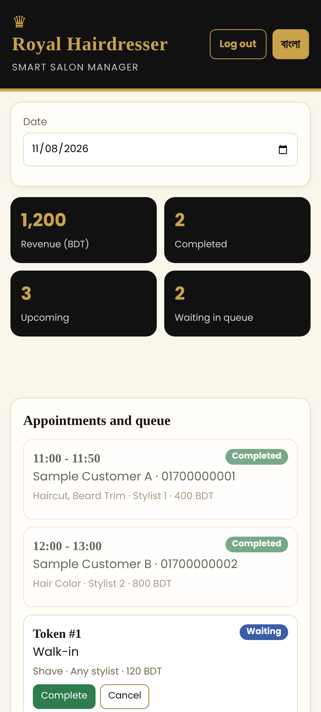
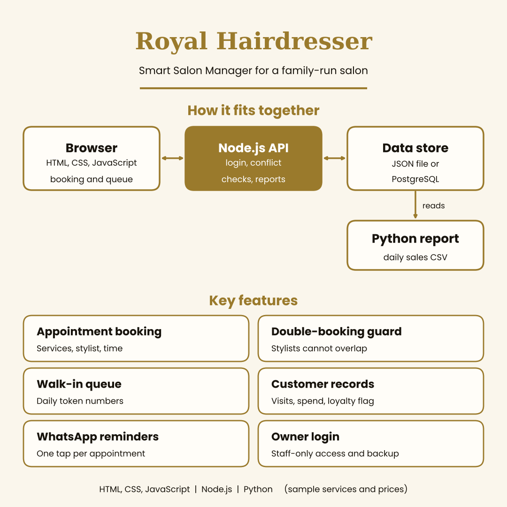

# Royal Hairdresser: Smart Salon Manager



A web app for managing a salon day: appointments, a walk-in queue, customer records and daily sales. I am building it for **Royal Hairdresser**, my brother's salon, to replace paper notes and phone-call bookings.

> **Status: prototype (version 1).** The services and prices in `seed.json` are **sample values**, and the customers shown are made-up demo entries. Replace them with the salon's real price list before real use.

## Features

| Feature | Description |
|---|---|
| Appointment booking | Pick services, a stylist and a time; duration and total price are calculated automatically |
| Double-booking guard | A stylist cannot be booked for overlapping times; bookings must fit opening hours |
| Walk-in queue | Walk-ins get a token number that restarts each day |
| Status tracking | Complete, cancel or mark no-show; completing a visit records the revenue |
| Customer records | Visit count and total spend per customer, with a loyalty-visit reminder every 5th visit |
| WhatsApp reminders | One tap opens WhatsApp with a ready appointment reminder message |
| Daily dashboard | Revenue, completed visits, upcoming bookings and queue length for any date |
| Owner login | Customer data is private: nothing is visible until the owner logs in |
| Backup | The owner can download all data as a JSON file |
| Bilingual UI | English and Bangla (button in the header) |
| Sales report | Python script for daily revenue, top services, stylist revenue and busy hours |

## Design



## Tech stack

- **Backend:** Node.js (built-in `http` module, no framework)
- **Frontend:** HTML, CSS and vanilla JavaScript
- **Storage:** JSON file by default, PostgreSQL when `DATABASE_URL` is set
- **Reporting:** Python (standard library only)
- **Tests:** Node's built-in test runner and plain Python asserts

## Run it locally

```bash
ADMIN_PASSWORD="choose-a-long-password" node server.js
```

Open `http://localhost:3100`, press **Owner login** and sign in as `admin`. Requires Node.js 18 or newer.

If you start without `ADMIN_PASSWORD`, a random temporary password is printed in the console and changes on every restart.

## Environment variables

| Variable | Purpose |
|---|---|
| `ADMIN_USER` | Owner username (default `admin`) |
| `ADMIN_PASSWORD` | Owner password. Use a long one; never commit it |
| `SESSION_SECRET` | Long random string used to sign login cookies. If unset, a random one is used and logins reset on restart |
| `DATABASE_URL` | PostgreSQL connection string for permanent storage. If unset, `data.json` is used |
| `EMPTY_START` | `true` starts with no sample appointments (use this for real data) |
| `PUBLIC_DEMO` | `true` lets visitors view the sample data read-only without logging in (for a public demo only) |
| `PORT` | Port to listen on (default 3100) |

## Security

- Passwords are checked with scrypt; credentials come from environment variables, never from the code
- Signed, expiring, HttpOnly session cookie (SameSite=Lax; Secure behind HTTPS)
- CSRF token required on every write
- Login lockout after repeated failed attempts
- Input validation, including Bangladeshi mobile number checks
- Security headers (CSP, X-Frame-Options, X-Content-Type-Options, Referrer-Policy)
- Only the front-end files are served; source and data files are not exposed

## Permanent storage

Free hosting plans usually delete local files on restart, so on a host set `DATABASE_URL` to a PostgreSQL database. The app creates one small table and keeps all data in it. This path is tested with a simulated database connection, not a live PostgreSQL server, so test it with your own database before relying on it. Use **Download backup** regularly.

## Deploy (for example on Render)

1. Push this repository to GitHub.
2. Create a new **Web Service** from the repository: build command `npm install`, start command `npm start`.
3. Add the environment variables above (at least `ADMIN_PASSWORD` and `SESSION_SECRET`; add `PUBLIC_DEMO=true` only for a public demo).
4. Open the generated URL.

## Customising

- Edit `seed.json` to set the shop name, opening hours, stylists, services, durations and prices
- `loyaltyEvery` in `seed.json` controls which visit triggers the loyalty reminder; the reward itself is up to the owner

## API

| Method | Endpoint | Purpose |
|---|---|---|
| GET | `/api/state?date=YYYY-MM-DD` | Day's appointments, summary, services and regular customers |
| GET | `/api/customer?phone=01XXXXXXXXX` | Customer history and loyalty flag |
| POST | `/api/appointments` | Book an appointment |
| POST | `/api/walkins` | Add a walk-in to the queue |
| POST | `/api/appointments/:id/status` | Mark completed, cancelled or no-show |
| GET | `/api/export` | Download a JSON backup |
| POST | `/api/login`, `/api/logout` | Owner session |

All endpoints except login need the owner session (or `PUBLIC_DEMO=true` for read-only viewing).

## Tests and reports

```bash
node --test test.js        # backend, login and storage tests
python test_report.py      # report tests
python sales_report.py     # sales summary, saved as daily_sales.csv
```

`sales_report.py` reads `data.json` (or `seed.json` if there is none). With PostgreSQL storage, use the downloaded backup file: `python sales_report.py salon-backup.json`.

## Files

```
server.js         REST API and static file server
auth.js           Owner login and sessions
store.js          JSON file / PostgreSQL storage
index.html        Page structure
style.css         Styling (black and gold theme)
app.js            UI logic, English/Bangla text, WhatsApp links
sales_report.py   Python sales report
seed.json         Sample shop, services and stylists
test.js           Backend tests
test_report.py    Report tests
```

## Limitations and next steps

- One owner account; separate staff accounts with roles are a natural next step
- Data is stored as one JSON document; a fuller database design would suit heavier use
- Possible additions: online booking page for customers, SMS reminders, product stock, staff commission reports

## Author

Mahbub Ullah, B.Sc. in CSE, International Islamic University Chittagong (IIUC)
